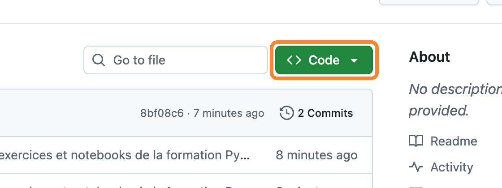
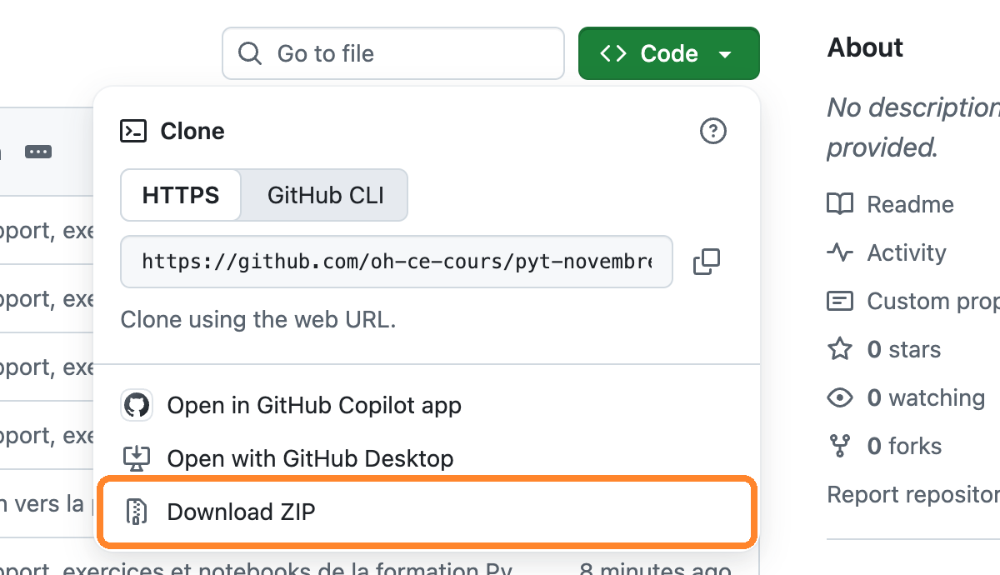

# Python pour l'analyse de données — 18, 19 et 20 novembre 2026

Formateur : Matthieu Falce, matthieu@falce.net

Page de la formation (horaires, ressources) : https://matthieu-falce.notion.site/Orsys-PYT-Novembre-2026-41bfd641a63681a19365eb394bf1a39e

Ce dossier est mis à jour en continu pendant les trois jours : `git pull` (ou Code › Download ZIP) pour récupérer ce qui a été tapé en cours, dans `tape_en_cours/`.

Sans git : bouton Code › Download ZIP, à refaire pour récupérer les nouveautés.

1. Cliquez sur le bouton vert **Code**, en haut à droite de la liste des fichiers.

   

2. Cliquez sur **Download ZIP**, en bas du menu.

   

## Contenu de ce dossier

| Fichier | Quoi | Quand |
|---|---|---|
| `support_cours.pdf` | le support de cours, une partie par jour, liens cliquables | à garder ouvert pendant les trois jours |
| `annexes.pdf` | les annexes : l'écosystème Python, les environnements et paquets, des compléments de langage… | pour aller plus loin, après la formation |
| `sujets_exercices.pdf` | les énoncés des exercices : syntaxe, débogage et tests, Matplotlib, Dash | au fil des trois jours |
| `exercices/medias/` | les fichiers des exercices (CSV, scripts à déboguer) | avec `sujets_exercices.pdf` |
| `notebooks/` | les notebooks du fil rouge, un par jour (`J1_…`, `J2_…`, `J3_…`) | à ouvrir dans JupyterLab |
| `notebooks/aide_memoire_sas_pandas.md` | les équivalents SAS → pandas (PROC SORT, PROC MEANS, PROC FREQ, PROC SQL, MERGE…) | en continu |
| `tape_en_cours/` | ce que je tape pendant la formation | mis à jour en direct |

Les corrections des notebooks et des exercices sont ajoutées dans ce dossier à la fin de la formation.

## Les données

Le fil rouge est un portefeuille d'assurance fictif (données générées, aucune donnée réelle) :
- `notebooks/donnees/clients.csv` : 2 033 clients
- `notebooks/donnees/contrats.csv` : 3 200 contrats (auto, habitation, santé, prévoyance)
- `notebooks/donnees/sinistres.csv` : 1 602 sinistres
- `notebooks/donnees/assurance.db` : les mêmes tables dans une base SQLite, pour la partie SQL

Les CSV sont au format d'un export SAS ou Excel français : encodage Windows (cp1252), séparateur point-virgule, virgule décimale, dates JJ/MM/AAAA. Ils contiennent volontairement quelques anomalies (doublons, valeurs mal saisies, codes postaux tronqués) : les trouver fait partie des exercices.

## L'environnement

On travaille dans l'environnement JupyterLab fourni pour la formation : Python 3.11, pandas 2.3, matplotlib, seaborn, plotly, ipywidgets, vertica-python et verticapy 1.0. Rien à installer.

Quelques outils cités dans le support ne sont pas installés dans cet environnement (dash, pytest, polars, duckdb, linters) : ils sont montrés en démonstration.
